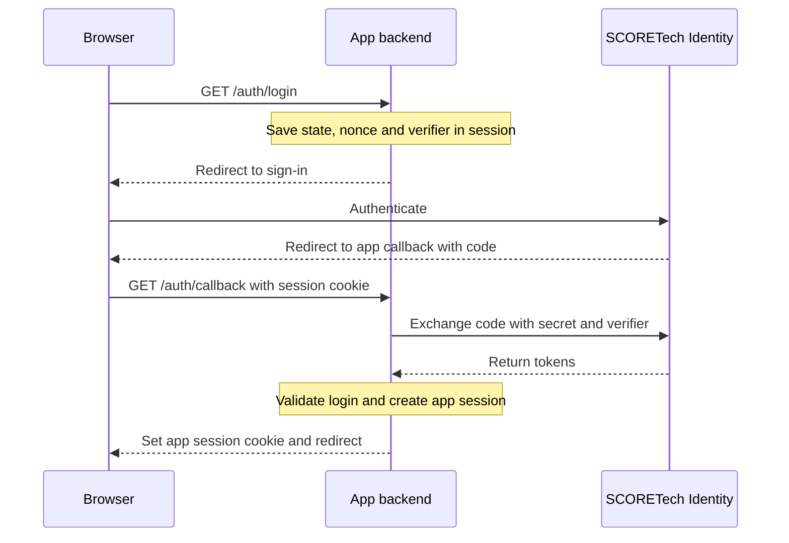

Use this walkthrough when your server owns the application's login session and can store the Client Secret. Start with **Backend application** credentials from [Getting started](./integration.md). The steps apply to any OIDC library. The example shows the protocol calls with Node.js 20 or later and `openid-client` v6.

## 1. Set the configuration on the server

Deploy the backend where it can reach the issuer and the endpoints advertised in discovery. Set the registered callback and optional post-logout URL as well as the Client ID. Inject `SCORETECH_CLIENT_SECRET` through your server's secret manager.

```dotenv
SCORETECH_ISSUER=https://sphere.score.us.es/identity/auth/realms/score
SCORETECH_CLIENT_ID=REPLACE_WITH_YOUR_CLIENT_ID
SCORETECH_CALLBACK_URL=https://portal.example.org/auth/callback
SCORETECH_POST_LOGOUT_URL=https://portal.example.org/
```

Expose `GET /auth/login` and `GET /auth/callback` through the app's HTTPS origin. Use your framework's server-side session store. Set its session cookie to `HttpOnly`, `Secure` and `SameSite=Lax` so it accompanies the top-level GET back from SCORETech Identity.

## 2. Redirect from the login route

Install the library in the backend and initialize it once at startup. This example authenticates the backend at the token endpoint with `client_secret_basic`.

```bash
npm install openid-client@6
```

```js title="scoretech-oidc.mjs"
import * as oidc from 'openid-client';

const { SCORETECH_ISSUER, SCORETECH_CLIENT_ID, SCORETECH_CLIENT_SECRET,
  SCORETECH_CALLBACK_URL } = process.env;

const config = await oidc.discovery(
  new URL(SCORETECH_ISSUER),
  SCORETECH_CLIENT_ID,
  SCORETECH_CLIENT_SECRET,
  oidc.ClientSecretBasic(SCORETECH_CLIENT_SECRET),
);
oidc.enableNonRepudiationChecks(config);

export async function startSignIn() {
  const transaction = {
    state: oidc.randomState(),
    nonce: oidc.randomNonce(),
    verifier: oidc.randomPKCECodeVerifier(),
  };
  const url = oidc.buildAuthorizationUrl(config, {
    response_type: 'code',
    redirect_uri: SCORETECH_CALLBACK_URL,
    scope: 'openid profile email',
    state: transaction.state,
    nonce: transaction.nonce,
    code_challenge: await oidc.calculatePKCECodeChallenge(transaction.verifier),
    code_challenge_method: 'S256',
  });
  return { url, transaction };
}

export async function finishSignIn(callbackQuery, transaction) {
  const callback = new URL(SCORETECH_CALLBACK_URL);
  callback.search = callbackQuery;
  const tokens = await oidc.authorizationCodeGrant(config, callback, {
    expectedState: transaction.state,
    expectedNonce: transaction.nonce,
    pkceCodeVerifier: transaction.verifier,
  });
  const { iss, sub } = tokens.claims();
  return { identity: { issuer: iss, subject: sub }, tokens };
}
```

In `GET /auth/login`, call `startSignIn()`. Save `transaction` with a short expiration in the browser's server-side session. Complete that save before redirecting the browser to `url`. The transaction ties the eventual callback to the browser that started the login.

## 3. Exchange the code at the callback

1. In `GET /auth/callback`, read and consume the saved transaction once. If it is missing or expired, ask the user to start again.
2. Pass the raw query string and the transaction to `finishSignIn()`. The library checks state and exchanges the code with the original PKCE verifier. It validates the ID token's signature, issuer, audience, expiry and nonce.
3. If the provider returns an error or validation fails, show a sign-in error and leave the user signed out. Avoid logging the callback query or any tokens.
4. On success, look up or create the app's own user using the pair `(issuer, subject)`. Keep the local user ID and any existing data linked to it. For existing users, plan a verified account-linking process before switching login. Email addresses can change.
5. Regenerate the app session ID and sign the user into the app. Keep any tokens needed for later use on the server and redirect to an app page without the callback query string. [openid-client authorization code grant](https://github.com/panva/openid-client/blob/main/docs/functions/authorizationCodeGrant.md)



## 4. Handle refresh and sign-out

- If the app uses an access token for later API calls, refresh it on the server before expiry. With `openid-client`, use `refreshTokenGrant`. Serialize refresh per session and save the latest tokens together, including any replacement refresh token. A successful refresh should preserve the app session.
- If the provider rejects refresh because the session expired, was revoked or lost required permissions, end the app session and show a sign-in action. A temporary network failure can be retried.
- On sign-out, clear the app session. For central sign-out, redirect the browser to the discovered `end_session_endpoint` with the saved ID token as `id_token_hint` and the registered `post_logout_redirect_uri`. With `openid-client`, use `buildEndSessionUrl`. [OIDC RP-Initiated Logout](https://openid.net/specs/openid-connect-rpinitiated-1_0.html)

Continue with [Verify your integration](./verify.md).
