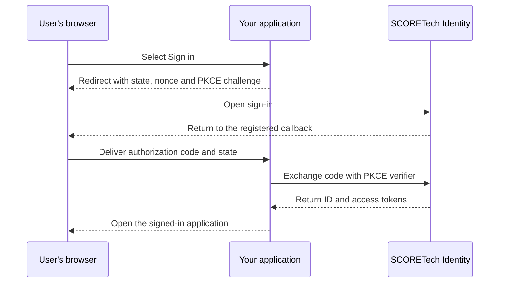

Use SCORETech Identity to sign users in through OpenID Connect (OIDC). This guide takes you from requesting a client to verifying your first login.

## 1. Choose your client type

Choose based on where the authorization code is exchanged for tokens.

| Where the exchange happens | Request | You receive |
| --- | --- | --- |
| JavaScript running in the browser | **Browser application** (public client) | Client ID |
| Your server, including a backend for a web frontend | **Backend application** (confidential client) | Client ID and Client Secret |

Both use Authorization Code with PKCE S256. Store the Client Secret in your server's secret manager or protected environment.

## 2. Request your client

Email [agarcia29@us.es](mailto:agarcia29@us.es). The SCORETech team registers your application and issues its credentials. Copy the request below and replace the example values.

```text title="Example client request"
Subject: SCORETech Identity client request — Research Portal (staging)

Application: Research Portal
Environment: staging
Client type: Backend application
Origin: https://portal-staging.example.org
Sign-in callback: https://portal-staging.example.org/auth/callback
After sign-out: https://portal-staging.example.org/
Who needs access: Research Portal members
Test access: Please arrange access for one test account.
```

- **Origin** means the scheme, host and port, with no path or trailing slash.
- **Sign-in callback** is where the browser returns with the authorization code. Provide at least one and up to ten exact URLs on the application's origin. Use HTTPS and give the full path, including any trailing slash. Wildcards are unavailable.
- **After sign-out** is optional. If you want users to land back in your application after central sign-out, provide the exact return URL on the same origin.
- **Who needs access** tells the team which users should receive the required application permissions. Ask for a separate client for each environment on a different origin.

## 3. Configure your OIDC client

Keep the settings issued to your application next to these shared settings.

| Setting | Value |
| --- | --- |
| Issuer | `https://sphere.score.us.es/identity/auth/realms/score` |
| Discovery | [OpenID configuration](https://sphere.score.us.es/identity/auth/realms/score/.well-known/openid-configuration) |
| Flow | Authorization Code (`response_type=code`) |
| PKCE | `S256` |
| Scopes | `openid profile email` |
| Redirect URI | Your registered sign-in callback |

Point your library at the issuer and use discovery for the authorization, token, signing-key and logout endpoints. The browser example uses the Keycloak adapter, which takes the Keycloak base URL and realm separately. [Keycloak OIDC guide](https://www.keycloak.org/securing-apps/oidc-layers)



In a browser application, the application exchanges the code in the browser. In a backend application, the server performs that step and supplies its Client Secret.

## 4. Follow the walkthrough and test sign-in

1. Follow the [browser walkthrough](./browser.md) for a public client or the [backend walkthrough](./backend.md) for a confidential client.
2. Run the [verification checklist](./verify.md) with the account granted access. Use the troubleshooting table if a step fails.
