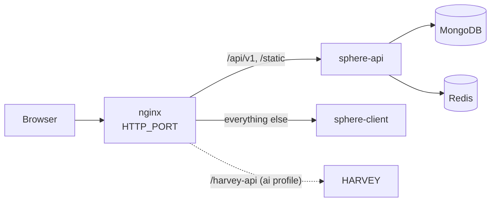

# Deploy your own SPHERE instance

This guide runs SPHERE on a server of yours from the published container images, so your pricings and accounts stay on your own infrastructure. Everything it needs is in the [`docker/self-hosted`](https://github.com/SCORELabUS/SPHERE/tree/main/docker/self-hosted) folder of the SPHERE repository: a Docker Compose file, an example configuration and the nginx routes.

## What you get



| Service | Image | Data |
| --- | --- | --- |
| `server` | `ghcr.io/scorelabus/sphere-api` | Pricing files and avatars in the `sphere-statics` volume |
| `client` | `ghcr.io/scorelabus/sphere-client` | None |
| `mongodb` | `mongo:7.0.16` | Accounts, organizations, pricings in the `mongodb-data` volume |
| `redis` | `redis:7.4.2` | Cache, rate limits and short-lived sign-in state |
| `nginx` | `nginx:1.27.3-alpine` | None |

HARVEY and the services it uses join with the `ai` profile, described in [AI assistants](./03-ai-assistants.mdx).

## Requirements

- A Linux server with [Docker](https://docs.docker.com/engine/install/) and Docker Compose 2.30 or later. The SPHERE images run on `amd64` and `arm64`; the AI services only on `amd64`.
- A domain name that points to the server, such as `sphere.example.com`.
- An HTTPS certificate for it, usually from a reverse proxy you already run or from [Caddy](https://caddyserver.com), which obtains one by itself. See [Serve it over HTTPS](#4-serve-it-over-https).
- A [Brevo](https://www.brevo.com) account to send email. New accounts confirm their address by email, so sign-up needs it. You can start without it and verify accounts by hand, as shown in [Create the first account](#5-create-the-first-account).

## 1. Get the files

```bash
git clone https://github.com/SCORELabUS/SPHERE.git
cd SPHERE/docker/self-hosted
cp .env.example .env
```

The Compose file uses the repository's `api/init-mongo.sh` to create the database user, so keep the folder inside the clone.

## 2. Configure it

Edit `.env`. These values are required:

| Variable | Value |
| --- | --- |
| `SPHERE_URL` | The address users open, without a trailing slash: `https://sphere.example.com`. Links, emails, permanent links and OAuth use it. |
| `MONGO_ROOT_PASSWORD` | Password of MongoDB's administrator. |
| `MONGO_PASSWORD` | Password of the database user the API connects with. |
| `JWT_SECRET` | Key that signs the sessions. Changing it signs everyone out. |

Generate each secret with:

```bash
openssl rand -hex 32
```

Use letters and digits only for the two MongoDB passwords: they go into a connection URL. The MongoDB passwords are applied on the first start, when the database is created; changing them later in `.env` does not change them in MongoDB.

Then set the optional parts you need:

- **Email**: `BREVO_API_KEY` and `BREVO_SENDER_EMAIL`, a sender address verified in Brevo.
- **Google sign-in**: `GOOGLE_CLIENT_ID` and `GOOGLE_CLIENT_SECRET`, from a Google Cloud OAuth client whose authorized redirect URI is `<SPHERE_URL>/api/v1/users/auth/sso/google/callback`.
- **Version**: the kit runs the SPHERE release it comes with, so it only changes when you update it. `SPHERE_VERSION` picks another release, such as `2.14.0`; the releases are listed on [GitHub](https://github.com/SCORELabUS/SPHERE/releases).

Every variable is described in the [configuration reference](./04-configuration-reference.mdx).

## 3. Start it

```bash
docker compose up -d
docker compose ps
```

On each start the API applies any pending database migrations before it accepts requests. Follow it with `docker compose logs -f server` until it prints the API address.

Check that nginx reaches the API:

```bash
curl http://localhost/api/v1/auth/config
```

It answers with a small JSON document such as `{"provider":"local",...}`.

## 4. Serve it over HTTPS

nginx listens on plain HTTP, on `HTTP_PORT` (80 by default). Put HTTPS in front of it with the tool you already use. With Caddy installed on the same server, set `HTTP_PORT=8081` in `.env`, run `docker compose up -d` again and use this `Caddyfile`:

```text title="/etc/caddy/Caddyfile"
sphere.example.com {
    reverse_proxy localhost:8081
}
```

Caddy obtains and renews the certificate by itself. Behind any other proxy, forward the requests to `HTTP_PORT` with the `Host`, `X-Forwarded-For` and `X-Forwarded-Proto` headers, and allow long-lived responses: notifications and the assistants stream their answers.

## 5. Create the first account

Open your `SPHERE_URL` and select **Register**. With email configured, confirm the address from the email you receive, then sign in.

Without email, the account is created but cannot sign in until its address is verified. Verify it from MongoDB, replacing `alice` with the username:

```bash
docker compose exec mongodb sh -c 'mongosh --quiet -u root -p "$MONGO_INITDB_ROOT_PASSWORD" --authenticationDatabase admin sphere --eval "db.users.updateOne({ username: \"alice\" }, { \$set: { emailVerified: true } })"'
```

The same command with `role: "ADMIN"` added to the `$set` makes the account a platform administrator, who can see and manage every organization and pricing. Give that role only to the people who operate the instance.

## Update

Update the kit to the new release, which also brings its nginx routes and AI service versions, then pull the images:

```bash
git fetch --tags && git checkout vX.Y.Z   # the release to run
docker compose pull
docker compose up -d
```

The API migrates the database on its first start. Read the [release notes](https://github.com/SCORELabUS/SPHERE/releases) before moving to a new release, and take a backup first.

## Back up and restore

SPHERE keeps its state in two places: the MongoDB database and the `sphere-statics` volume, which holds the pricing YAML files and avatars. Back up both, at the same time.

```bash
# Database
docker compose exec -T mongodb sh -c 'mongodump --quiet --archive -u root -p "$MONGO_INITDB_ROOT_PASSWORD" --authenticationDatabase admin --db sphere' > sphere-db.archive

# Pricing files and avatars
docker compose run --rm --no-deps -v "$PWD":/backup --entrypoint tar server czf /backup/sphere-statics.tgz -C /usr/src/server/public .
```

To restore them into a stopped instance:

```bash
docker compose stop server
docker compose exec -T mongodb sh -c 'mongorestore --quiet --drop --archive -u root -p "$MONGO_INITDB_ROOT_PASSWORD" --authenticationDatabase admin' < sphere-db.archive
docker compose run --rm --no-deps -v "$PWD":/backup --entrypoint tar server xzf /backup/sphere-statics.tgz -C /usr/src/server/public
docker compose start server
```

Redis holds only data SPHERE rebuilds, so it needs no backup.

## Troubleshooting

| Symptom | Cause and fix |
| --- | --- |
| Sign-up says the verification email could not be sent | Email is not configured. Set `BREVO_API_KEY` and `BREVO_SENDER_EMAIL`, or verify the account by hand as in [step 5](#5-create-the-first-account). |
| The site does not load and the API log shows `Authentication failed` | The MongoDB passwords in `.env` changed after the database was created. Restore the original values. |
| Links in emails or permanent links point to the wrong address | `SPHERE_URL` is wrong. Fix it and run `docker compose up -d`. |
| `/harvey-api` answers 502 | The AI services are not running. Start them with `docker compose --profile ai up -d`. |
| Anything else | Read the logs: `docker compose logs server` (or `client`, `nginx`, `mongodb`). |

To report a problem, open an [issue in the SPHERE repository](https://github.com/SCORELabUS/SPHERE/issues).
